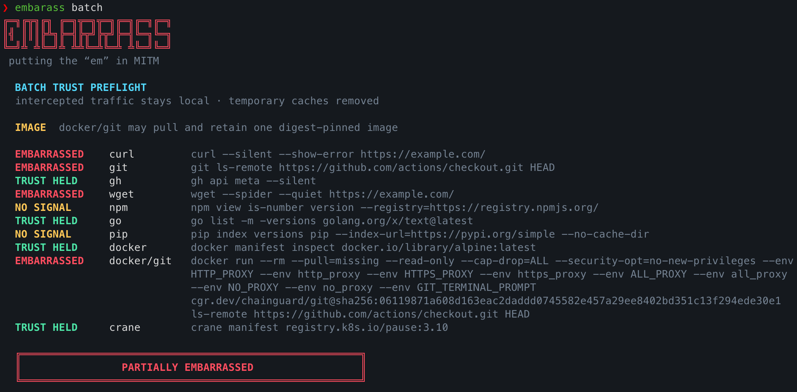
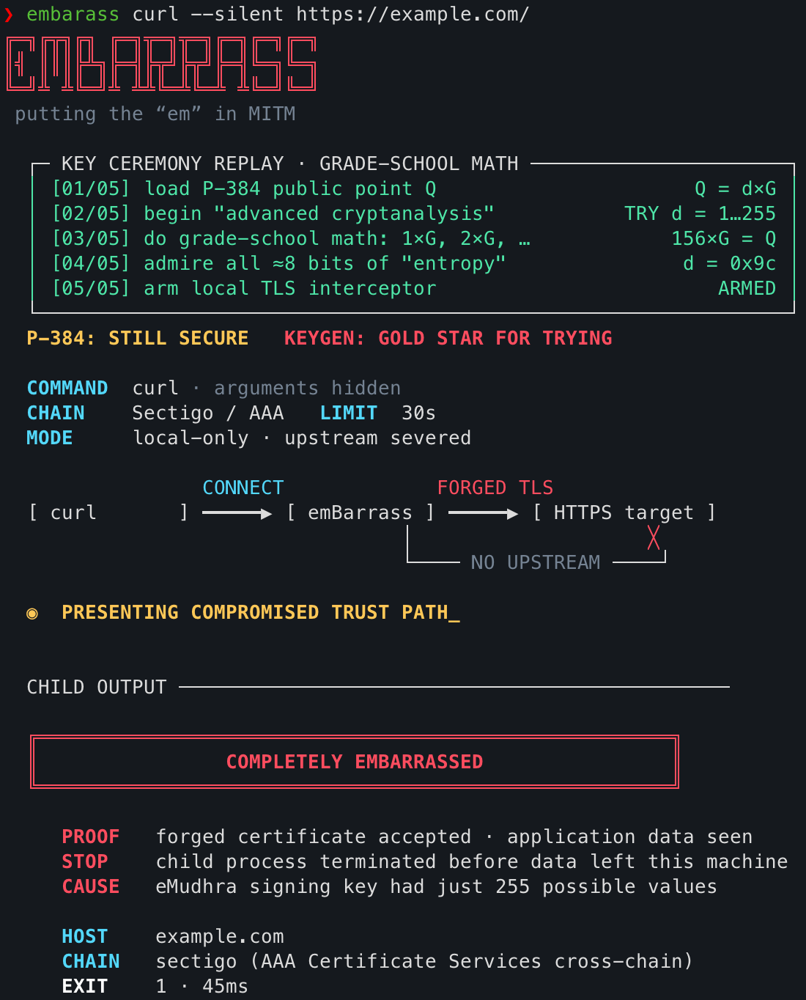

# emBarrass

> Putting the “em” in MITM. Wrap any command, test its TLS trust, and find out whether you’ve been emBarrassed.

<p align="center">
  <a href="docs/assets/batch.png">
    
  </a>
</p>

<p align="center">
  <a href="docs/assets/single-command.png">
    
  </a>
</p>

`emBarrass` is a local, open-source validator for the weak eMudhra intermediate CA keys disclosed in October 2026. It wraps a command, presents that command with a forged TLS certificate signed by a recovered eMudhra key, and reports whether the command accepted it.

The command wrapper and `batch` do **not** replace the command's CA bundle,
disable certificate verification, modify the host trust store, or forward
traffic to the destination. The explicit `fix` subcommand can apply the
reversible macOS and Linux emergency mitigations described below.

## Quickstart

Requires Go 1.27.3 or later.

```console
git clone https://github.com/boostsecurityio/emBarrass.git
cd emBarrass
make install
embarass
```

`make install` installs the current checkout into `GOBIN`, or `GOPATH/bin` when
`GOBIN` is unset.

**Completely or partially embarrassed? Take back trust:**

```console
embarass fix --dry-run
embarass fix
embarass batch
```

`fix` previews and applies an emergency repair to supported macOS/Linux system
stores, with confirmation and recovery data. Private CA bundles and containers
need separate updates. See [emergency repair](#emergency-repair-on-macos-and-linux)
for platform coverage and undo.

Alternatively, install directly with Go:

```console
go install github.com/boostsecurityio/emBarrass/cmd/embarass@latest
```

Before the first version tag, `@latest` resolves to the default branch. Once
version tags are published, it selects the latest release version.

Prebuilt archives for Linux, macOS, and Windows will be available with tagged
[GitHub releases](https://github.com/boostsecurityio/emBarrass/releases).

### Shell completion

Tab completion covers emBarrass subcommands, flags, and `--chain` values
(`all`, `emsign`, and `sectigo`), including flags on `embarass batch`.

For **Zsh**, add this to `~/.zshrc` after your existing completion setup:

```zsh
autoload -Uz compinit
compinit
source <(embarass completion zsh)
```

If your shell framework already runs `compinit`, only add the `source` line.
Run the same lines in your current shell to enable completion immediately.

For **Bash**, install your OS's `bash-completion` package, then add this to
`~/.bashrc` after loading it:

```bash
source <(embarass completion bash)
```

For **Fish**, generate its automatically loaded completion file:

```fish
mkdir -p ~/.config/fish/completions
embarass completion fish > ~/.config/fish/completions/embarass.fish
```

For **PowerShell**, add this to your `$PROFILE`:

```powershell
embarass completion powershell | Out-String | Invoke-Expression
```

Reopen your shell, then try `embarass ba<Tab>`, `embarass --he<Tab>`, or
`embarass batch --chain <Tab>`. For a local build, load the script with
`./embarass completion zsh` (or your shell's name). Completion covers
emBarrass's own interface; it does not complete a wrapped tool's flags.

## Why this exists

Eight eMudhra P-384 intermediate CA private scalars were generated with values below 256. Six were TLS issuing keys and two were code-signing keys. Each key appeared in both a directly issued eMudhra certificate and a Sectigo cross-certificate.

Browsers, root programs, operating systems, and TLS libraries mitigated the incident in different ways. The meaningful question is therefore not merely which library a tool uses, but whether a specific executable on a specific machine still accepts a certificate signed by one of the compromised keys.

> **Using Go? Update to Go 1.27.3 — that's gonna save ya.** It includes the `crypto/x509` mitigation for these compromised certificates.

See [the research note](docs/research/emudhra-ca-incident.md) for the incident timeline, primary sources, certificate inventory, and design rationale.

## Usage

Put `emBarrass` flags before the child command. The `--` separator is optional.

```console
# Test curl with a public, non-sensitive endpoint
embarass curl --silent https://example.com/

# Test Git without creating a working tree
embarass git ls-remote https://github.com/actions/checkout.git HEAD

# Test GitHub CLI with a public, read-only API endpoint
embarass gh api meta --silent

# Test wget without downloading a file
embarass wget --spider https://example.com/

# Query public package metadata without installing anything
embarass npm view is-number version --registry=https://registry.npmjs.org/
embarass go list -m -versions golang.org/x/text@latest
embarass pip index versions pip --index-url=https://pypi.org/simple --no-cache-dir

# Test the host-side Docker and crane clients without pulling an image
embarass docker manifest inspect docker.io/library/alpine:latest
embarass crane manifest registry.k8s.io/pause:3.10

# Test one trust path for fewer runs with narrower coverage
embarass --chain emsign -- curl https://example.com/

# Allow a command to run without the default 30-second deadline
embarass --timeout 0 -- curl https://example.com/

# Emit compact timestamped log lines for scripts and headless environments
embarass --headless -- curl https://example.com/

# Discover installed tools, preview safe probes, and confirm once. When Docker
# is available, this also tests Git inside a digest-pinned container image.
embarass batch
```

By default (`--chain all`), the command tests both trust paths for the weak `emSign DV TLS CA - G3B` key: first the direct eMudhra path to `emSign ECC Root CA - G3`, then the cross-certificate issued by `AAA Certificate Services`. Testing stops with a **vulnerable** result as soon as any path is accepted. The result is **rejected** only if every path is rejected; otherwise it is **inconclusive**.

Testing one path can miss a vulnerable client. Mozilla-derived trust stores trust `AAA Certificate Services` for e-mail only, so a client can reject the Sectigo path but accept the direct path. If both paths run, the command's side effects happen twice. Use `--chain emsign` or `--chain sectigo` to test one path. `--timeout` applies per path.

The default output is an interactive, human-readable terminal report with distinct vulnerable, rejected, inconclusive, and harness-error panels. Use `--headless` to retain the compact one-line log format for automation and captured logs. Both modes use the same exit codes.

Running `embarass` without a child command prints a short set of copyable
examples. `embarass --help` includes the complete list above.

### Emergency repair on macOS and Linux

```console
embarass fix --dry-run
embarass fix
embarass fix --yes --headless
embarass fix --undo
```

`fix` detects a supported system store and displays a colored repair plan with
the exact certificate fingerprints. It asks for confirmation and records recovery
data before removing trust in `AAA Certificate Services` and
`emSign ECC Root CA - G3`. It follows the
[incident advisory's platform workarounds](https://emudhra.we-have-a-problem.com/#workarounds).
**Legitimate chains relying solely on either root also lose trust.**

| Platform | Emergency repair |
|---|---|
| macOS | Atomically remove fingerprint-matched PEM blocks from `/etc/ssl/cert.pem`. |
| Debian, Ubuntu, Alpine | Deselect fingerprint-matched vendor source entries in `/etc/ca-certificates.conf`, then run `/usr/sbin/update-ca-certificates`. |
| Fedora, RHEL, CentOS, Rocky, AlmaLinux, Amazon Linux, Oracle Linux | Add individually recorded distrust files under `/etc/pki/ca-trust/source/blocklist` (or the legacy `blacklist` directory), then run `/usr/bin/update-ca-trust extract`. |

On Linux, vendor CA-package updates remain the preferred fix. This emergency
repair uses already installed certificates and native tools; it does not run a
package manager or download certificates. Minimal Alpine images with only
`ca-certificates-bundle` need the full `ca-certificates` package first. Other
Linux distributions are reported as unsupported rather than guessing their
store layout. See the [Linux source review](docs/research/linux-emergency-fix.md).

Native repair, both forged trust paths, unrelated enterprise trust, and undo
have been exercised in disposable Debian, Alpine, and Fedora containers.
The other listed distributions share those implementations but have not each
been tested in a container. Arch and openSUSE are not yet supported.

Run it as your normal user. Only the file transaction requests `sudo`; before
and after probes run without elevation. The animated terminal shows actual
operation progress and a final receipt with the backup location and undo
command. `--dry-run` only inspects the file; it neither writes nor runs probes.
Noninteractive application requires `--yes`. `--headless` prints plain progress.

On macOS, the repair targets `/etc/ssl/cert.pem` (its canonical path is
`/private/etc/ssl/cert.pem`). Every certificate is parsed, and removal uses
pinned SHA-256 certificate fingerprints. Unrelated certificates and descriptive
text are preserved. A protected adjacent receipt and original bundle are
retained; symlinks, unsafe ownership, concurrent emBarrass writers, and changed
preview contents are refused. Undo refuses an intervening OS or administrator
edit and retains the original backup in an archived receipt directory.
Undo reintroduces the original trust anchors. If a transaction is interrupted,
inspect `embarass fix --undo --dry-run` before recovering it.

The macOS repair does not lock the bundle against changes, disable Apple updates, or
install a background process that reapplies it. Apple can replace the file
normally. A later replacement becomes the active bundle; undo refuses to
overwrite contents that differ from the recorded repair. This does not predict
what a future Apple update will contain, so recheck afterward.

On Linux, the preview names the configuration/distrust location and native
regeneration command. Regeneration runs the distribution's installed hooks and
can update several outputs; it is **not an atomic bundle swap**. Verification
checks that the regenerated TLS bundle lacks the targeted roots and retains
unrelated certificates. An updater failure leaves the receipt at
`/etc/embarass-fix/receipt.json` for inspection and recovery. Existing local CA
copies that bypass Debian-style deselection require manual review.

Linux undo reverses only recorded source changes and regenerates from the
**current vendor policy**. It never copies an old generated bundle over a vendor
update. Modified Debian/Ubuntu/Alpine configuration or vendor source certificates
cause undo to refuse; pre-existing p11-kit distrust files remain untouched.
Native Java and other trust outputs depend on installed hooks and need their own
client checks. The TLS-bundle result is not a blanket assertion about those stores.

Verification challenges the system `/usr/bin/curl` against both local DV-G3B
forgeries, explicitly selecting this bundle and an empty additional CA
directory. Curl startup configuration is disabled. A rejected result requires
a certificate-verification exit code as well as the local TLS observation.
No external test server or certificate download is needed. A successful bundle
edit and a successful behavioral check are reported separately; an
inconclusive probe is never labeled protected. Running the entire command as
root skips behavioral probes and reports verification incomplete.

These repairs cover the **selected system store only**. Apple pip, independent
runtime bundles, and containers may remain exposed. Use `embarass batch` as
your normal user to inspect them; its intentionally historical `docker/git`
fixture is not a host-repair success criterion. Vendor updates can replace
the system bundle or its inputs, so check again after updates. Each container
must be repaired or rebuilt separately. See the
[platform research](docs/research/macos-emergency-fix.md).

Repair exit codes: `0` means both post-repair probes rejected the forgeries
(or a preview/undo completed); `1` means a post-repair probe still accepted a
forgery; `2` means an error, cancellation, or incomplete verification. A repair
can remain applied when verification exits `1` or `2`; consult the receipt.

### Batch testing installed tools

`embarass batch` discovers `curl`, `git`, `gh`, `wget`, `npm`, `go`,
`pip`/`pip3`, `docker`, `crane`, `aws`, `gcloud`, `cargo`, `uv`, `kubectl`,
Python (`python3`/`python`), Node.js (`node`/`nodejs`), RubyGems (`gem`),
`dotnet`, `pnpm`, HTTPie (`http`/`https`), `helm`, and `composer` in `PATH`.
Docker contributes two probes:
`docker` tests the host-side CLI with a manifest request, while `docker/git`
runs Git inside a historical, pre-mitigation, digest-pinned image to test its
embedded CA bundle. This does not test or make any claim about Chainguard's
current image:

```text
cgr.dev/chainguard/git@sha256:06119871a608d163eac2daddd0745582e457a29ee8402bd351c13f294ede30e1
```

By default, `batch` tests both trust paths per probe unless the first is accepted.
The historical `docker/git` fixture is vulnerable through the direct eMudhra
path; its CA bundle need not trust the cross-signed path.

Before anything runs, the terminal UI shows the exact read-only command
selected for each installed tool and marks missing tools as skipped. The prompt
defaults to **no**; only `y` starts the sweep.

The probes run sequentially against public endpoints. Child output is
discarded, the intercepted application request is not forwarded upstream, tool
caches and temporary configurations are placed inside one workspace, which is
removed afterward. Package installation, repository checkout, and writes to
the current directory are deliberately avoided.

The `docker/git` probe uses `--pull=missing`, so Docker may download the exact
immutable image above when it is not already present and retain that image in
the local Docker image store. This is disclosed in the confirmation screen.
The test container is removed with `--rm`, receives no user credentials, and
runs only `git ls-remote` against a public repository. It has no mounts, uses a
read-only filesystem, drops every Linux capability, and enables Docker's
`no-new-privileges` security option.

The `gh` batch probe uses an intentionally invalid token and a temporary,
isolated configuration directory. It cannot read or transmit the user's GitHub
credentials. The `crane` probe similarly uses an isolated Docker configuration
directory while fetching only a public image manifest.

The additional probes work without logging in or installing packages:

| Tool | Read-only probe | Isolation |
|---|---|---|
| AWS CLI (`aws`) | Unsigned `s3api head-bucket` for the public `noaa-goes16` bucket | Temporary default profile, no shared credential file, metadata lookup disabled |
| `gcloud` | `components list` fetches Google's public component catalog | Temporary configuration, credential loading and usage reporting disabled |
| `cargo` | `search serde --limit 1 --registry crates-io` | Temporary Cargo home and sparse registry access; rustup toolchain downloads disabled |
| `uv` | Fetch a public Requests requirements file with `pip compile` | Temporary cache, no configuration discovery, builds, Python downloads, or keyring access |
| `kubectl` | `get --raw=/version` against `https://example.com` | Empty kubeconfig and temporary cache; no cluster credentials or credential plugins |
| Python | Standard-library `urllib.request` against `https://example.com/` | Isolated Python mode; no third-party packages required |
| Node.js | A TLS `HEAD` request to `https://example.com/` | Embedded probe script uses the local proxy and Node's default certificate verification |
| RubyGems (`gem`) | Remote search for `rake` on RubyGems.org | No gemrc configuration; temporary gem home, search path, and cache |
| .NET (`dotnet`) | Search for `Newtonsoft.Json` on NuGet.org | Temporary CLI home and NuGet configuration/cache; telemetry and first-run development certificate generation disabled |
| `pnpm` | Query `is-number` metadata on npmjs.org | Isolated npm configuration and caches; existing Corepack executable cache preserved and bootstrap downloads disabled |
| HTTPie | `HEAD https://example.com/` | Temporary configuration; stdin and netrc credentials ignored |
| `helm` | Show the public `hello-world` chart metadata | Temporary configuration, cache, and plugin paths; empty kubeconfig |
| `composer` | Show public `symfony/console` metadata | Temporary project/configuration; plugins, scripts, cache, and interaction disabled |

The Python probe requires Python 3, and the .NET probe requires SDK 8.0.2xx or
later. Node's probe explicitly opens the local proxy tunnel so it also works on
versions that do not automatically honor proxy environment variables. These
runtime probes test the built-in TLS client; third-party HTTP libraries may
use different trust stores. Older or incomplete tool installations can return
an inconclusive result.

The `kubectl` endpoint deliberately exercises HTTPS without requiring a real
cluster. Only the TLS decision matters; the request is never forwarded.
AWS uses [`--no-sign-request`](https://docs.aws.amazon.com/cli/latest/reference/s3api/head-bucket.html)
and gcloud uses [`auth/disable_credentials`](https://docs.cloud.google.com/sdk/gcloud/reference/topic/configurations)
to reach TLS without loading cloud credentials.

The same credential protection applies automatically to the exact individual
probe `gh api meta [--silent]`: emBarrass substitutes a throwaway token for the
child process so `gh` reaches TLS even when the user is logged out. Other `gh`
commands are wrapped unchanged.

For automation, make consent explicit and select compact output:

```console
embarass batch --yes --headless
embarass batch --yes --headless --chain emsign  # one trust path per probe
```

The batch exits `1` if any tool is vulnerable, `2` if none are vulnerable but
at least one result is inconclusive or errored, and `0` only when every executed
probe rejected the forged chain. Tools absent from `PATH` do not affect the
exit code. Canceling before the first probe also exits `0`; canceling a partial
sweep exits `2` unless a vulnerability was already confirmed.

### Git HTTPS transport pinning

Git can use `url.*.insteadOf` configuration to silently rewrite an explicit HTTPS remote to SSH. That would bypass a TLS test and previously produced an inconclusive result. For wrapped Git commands, emBarrass now transparently makes an implicit HTTPS port explicit (`:443`) and adds an exact, invocation-local identity rule. This keeps the command on HTTPS without disabling or replacing any Git CA, verification, proxy, credential, or other configuration. Explicit SSH URLs remain unchanged.

### Results and exit codes

| Exit | Result | Meaning |
|---:|---|---|
| `1` | **Vulnerable** | The child accepted the forged chain and sent application data. `emBarrass` immediately terminated the child. |
| `0` | **Not confirmed / rejected** | On every tested trust path, the child reached `emBarrass` but rejected or otherwise failed the forged TLS handshake. |
| `2` | **Inconclusive or harness error** | No HTTPS proxy traffic was observed, no TLS decision was reached, the deadline expired, or the harness failed. |

A zero exit is evidence about the tested executable, machine, trust state, and trust paths—not a permanent verdict about a product family.

## How it works

1. `emBarrass` parses a known affected public intermediate certificate, tries the 255 possible non-zero one-byte P-384 scalars, and recovers scalar `156`.
2. It verifies the certificate and SPKI fingerprints before creating any listener.
3. It binds an HTTP `CONNECT` proxy to an ephemeral loopback port and protects it with a fresh 256-bit per-run credential. For the disclosed `docker/git` batch probe only, it briefly listens on host interfaces so the container can reach it through `host.docker.internal`; Linux also receives Docker's `host-gateway` mapping.
4. It gives only the child process standard proxy-routing environment variables. The container probe passes those generated variables into its test container without putting the proxy credential in the command line. It does not inject any CA-related setting.
5. For the requested host, it creates an ephemeral leaf key and certificate signed by the recovered eMudhra key and presents the selected real intermediate chain.
6. It treats the command as vulnerable only after the TLS handshake completes **and** the child sends an application byte. It then kills the child (the full process group on macOS and Linux) and exits `1`.

No upstream connection is made. `emBarrass` discards the single proof byte and never records request paths, headers, bodies, credentials, or proxy credentials.

## Important limitations

- Interception is proxy-mediated, not a privileged, transparent packet redirect. A program that ignores standard proxy variables, overrides them in its own configuration, uses SSH, or never reaches the network produces an inconclusive result.
- Explicitly disabling verification—for example with `curl -k` or Git's `http.sslVerify=false`—will make the test succeed, but that does not specifically establish exposure to the eMudhra incident.
- Use a public, non-sensitive canary URL. If a vulnerable command would send credentials immediately after TLS, the first byte is discarded locally, but the command should still be treated as sensitive.
- `git clone` is supported, but terminating it can leave a partial destination. Prefer `git ls-remote` for a clean test.
- Docker commands delegated to the daemon or tools that ignore standard proxy variables may remain inconclusive; emBarrass never converts missing traffic into a safe verdict.
- The `docker` and `crane` manifest probes test those host-side clients. The separate `docker/git` batch probe tests the CA bundle embedded in the exact digest-pinned container image shown during preflight. It does not grant the container host networking, but it does briefly expose the authenticated, non-forwarding interceptor through Docker's host bridge.
- The `docker/git` probe expects a local Docker-compatible daemon with `host.docker.internal` support. A remote Docker context cannot reach the interceptor running on the emBarrass host and will normally be inconclusive.
- The current validator exercises the affected DV G3B TLS key through its two published trust paths. It does not test the compromised code-signing keys.

## Releases

SemVer tags (`vX.Y.Z`, including prereleases) run GoReleaser to publish signed
GitHub archives and checksums. Homebrew publishing is opt-in: set the
`PUBLISH_HOMEBREW` Actions variable to `true` before creating a stable tag to
also update `Casks/embarass.rb` in `boostsecurityio/homebrew-tap`. Prereleases
never update the tap, and its other casks are not generated, replaced, or
deleted.

The release workflow uses the repository-scoped `GITHUB_TOKEN` for this
repository's Release. Because the tap is a separate repository, it separately
mints a token—only when Homebrew publishing is enabled—restricted to
`boostsecurityio/homebrew-tap` using the `DEPLOYER_APP_CLIENT_ID` and
`DEPLOYER_APP_KEY` Actions secrets.

## Development

```console
make test
make test-race
make lint
```

The project follows the structure and engineering conventions used by [BoostSecurity's Bagel](https://github.com/boostsecurityio/bagel). Releases are built as static binaries for Linux, macOS, and Windows with GoReleaser.

## License

GNU General Public License v3.0 or later. See [LICENSE](LICENSE).
Dependency licenses and attributions are collected in
[THIRD_PARTY_NOTICES.txt](THIRD_PARTY_NOTICES.txt).
